# DigitalWork Freelance Escrow

ระบบจ้างงานและพักค่าจ้างด้วย Smart Contract บน Ethereum รองรับผู้ว่าจ้าง ฟรีแลนซ์ และผู้ตัดสิน เวอร์ชัน V1 จ่ายค่าจ้างเต็มงานครั้งเดียว ส่วน V2 เพิ่มการรับข้อตกลง การส่งแก้ตามรอบ และการจ่ายค่าจ้างรายงวด

[เปิดเว็บ V1](https://nopparatcsi.github.io/FreelanceSmartPlatform/) · [เปิดระบบรายงวด V2](https://nopparatcsi.github.io/FreelanceSmartPlatform/v2/) · [ผลทดสอบ](#ผลทดสอบและภาพหลักฐาน) · [ภาพรวม V2](#test-13) · [วิธีใช้งาน](#การใช้งานพื้นที่จัดการงาน)

## ผลทดสอบและภาพหลักฐาน

เอกสารนี้แสดงภาพผลทดสอบ **ครบ 14 ภาพ** พร้อมสถานการณ์ บทบาท สถานะงาน สิ่งที่อ่านได้จากภาพ และผลที่ชุดทดสอบตรวจเพิ่มเติม ภาพทุกภาพแสดงในหน้านี้ทันที และเปิดไฟล์ขนาดต้นฉบับได้จากชื่อไฟล์ใต้หัวข้อ

### ขอบเขตของหลักฐาน

ผลทดสอบที่บันทึกไว้ตรวจสอบวันที่ **18 พฤศจิกายน 2026** ภาพทั้งหมดถ่ายจากหน้าเว็บที่ใช้ **Hardhat Local, Chain ID 31337 และ ETH จำลอง** การเริ่มเดโมใหม่จะสร้างสัญญาและข้อมูลชุดใหม่ จึงทำให้วันเวลา Transaction Hash และ Contract Address ของแต่ละรอบต่างกันได้

ภาพ 01–08 เป็นการทดสอบ **V1** ภาพ 09 เป็นการทดสอบ **Wallet ของ V2** และภาพ 10–14 เป็นการทดสอบ **V2 แบบรายงวด** โหมดสาธิตใช้บัญชี Hardhat แยกบทบาทและให้เซิร์ฟเวอร์ส่งธุรกรรมแทน ส่วนชุดทดสอบ Wallet ใช้ตัวเชื่อม **EIP-1193 จำลอง** ลงนามด้วยบัญชี Hardhat

ภาพในหน้านี้ไม่ใช่ภาพการกดยืนยัน MetaMask บน Sepolia และ Hash ของเชน Local ค้นผ่าน Sepolia Etherscan ไม่ได้ บทบาทและ Wallet ที่เห็นในภาพเป็นชุดข้อมูลทดสอบ แยกจากบัญชี Sepolia ของโครงการ ส่วนการตรวจ Receipt, Event, ยอดเงินจริงบนเชนจำลอง และเงื่อนไขสิทธิ์ผู้ใช้ อธิบายไว้ในหัวข้อผลตรวจของแต่ละภาพ

| บทบาท | หน้าที่ในเส้นทางทดสอบ |
| --- | --- |
| ผู้ว่าจ้าง | สร้างข้อตกลง ฝากค่าจ้าง ตรวจผลงาน อนุมัติจ่าย และขอแก้ใน V2 |
| ฟรีแลนซ์ | รับข้อตกลงก่อนฝากใน V2 ส่งหลักฐานผลงาน และส่งเวอร์ชันแก้ไข |
| ผู้ตัดสิน | อ่านหลักฐานจากคู่สัญญา บันทึกเหตุผล และชี้ขาดให้จ่ายหรือคืนเงิน |
| คู่สัญญาทั้งสองฝ่าย | เปิดข้อพิพาทหรือส่งคำชี้แจงตามสิทธิ์ของตน เงินยังพักอยู่ระหว่างรอคำตัดสิน |

### สรุปผลชุดทดสอบ

| ชุดทดสอบ | สิ่งที่ตรวจ | ผลที่บันทึกไว้ |
| --- | --- | --- |
| `npm.cmd test` | Contract V1/V2: สิทธิ์ผู้ใช้ ลำดับสถานะ การจ่ายซ้ำ เวอร์ชันผลงาน ข้อพิพาท การโอนล้มเหลว และการเชื่อมสัญญาเดิม | ผ่าน 20 กรณี |
| `npm.cmd run test:web` | สร้างงาน → ฝาก → ส่งงาน → จ่าย, ข้อพิพาทแบบจ่าย/คืน, ประวัติ, Clipboard, การอัปเดตข้ามแท็บ และมือถือ | ผ่าน |
| `npm.cmd run test:web:v2` | รับงาน ส่งแก้ จ่ายครบ 3 งวด คืนเฉพาะยอดที่เหลือ ผู้ตัดสินสั่งจ่ายงวด และการใช้แท็บ/ค้นหา/มือถือ | ผ่าน |
| `npm.cmd run test:wallet` | ยกเลิกคำขอ ข้อผิดพลาด RPC ซ้อน ลงนามผ่าน EIP-1193, Receipt สำเร็จ และ Event `JobCreated` | ผ่านทั้ง V1 และ V2 |
| `npm.cmd run test:pages` | เปิด V1/V2 ใต้ path ของ GitHub Pages แยกข้อมูล เปิดประวัติ และสลับรุ่นได้ | ผ่าน |
| `npm.cmd run build:pages` | สร้างไฟล์เว็บ V1 และ V2 พร้อมเผยแพร่ | ผ่าน |

ภาพหน้าจอแสดงผลที่ผู้ใช้มองเห็น ส่วนข้อความ **ผลที่ชุดทดสอบยืนยัน** ระบุสิ่งที่ตรวจด้วยโค้ดเพิ่มเติม จึงไม่ใช้ภาพเพียงอย่างเดียวสรุปว่าการโอนหรือการควบคุมสิทธิ์ถูกต้อง ชุดทดสอบที่สัมพันธ์กับแต่ละภาพมีลิงก์กำกับไว้

### สารบัญภาพทั้งหมด

| ภาพ | รุ่น / หมวด | สถานการณ์ |
| --- | --- | --- |
| [01](#test-01) | V1 | ผู้ว่าจ้างสร้างข้อตกลงสำเร็จ |
| [02](#test-02) | V1 | ฝากค่าจ้างเข้า Escrow แล้ว |
| [03](#test-03) | V1 | ฟรีแลนซ์ส่งหลักฐานผลงาน |
| [04](#test-04) | V1 | ผู้ว่าจ้างอนุมัติจ่ายและตรวจประวัติ |
| [05](#test-05) | V1 | ผู้ตัดสินพิจารณาแล้วสั่งจ่ายให้ฟรีแลนซ์ |
| [06](#test-06) | V1 | ผู้ตัดสินสั่งคืนค่าจ้างให้ผู้ว่าจ้าง |
| [07](#test-07) | V1 | ภาพรวมเดสก์ท็อปหลังจบสามเส้นทางทดสอบ |
| [08](#test-08) | V1 | รายละเอียดข้อพิพาทบนหน้าจอมือถือ |
| [09](#test-09) | Wallet V2 | สร้างงานด้วยธุรกรรมที่ลงนามผ่าน EIP-1193 |
| [10](#test-10) | V2 | ผู้ว่าจ้างตรวจผลงานงวดแรกก่อนอนุมัติ |
| [11](#test-11) | V2 | ประวัติรับงาน ส่งแก้ และจ่ายครบทั้งสามงวด |
| [12](#test-12) | V2 | ข้อพิพาทคืนเฉพาะยอดที่ยังไม่จ่าย |
| [13](#test-13) | V2 | ผู้ตัดสินสั่งจ่ายงวดที่พิพาทแล้วทำงานต่อจนจบ |
| [14](#test-14) | V2 | ภาพรวมงานที่จบแล้วบนมือถือ |

### ข้อมูลตัวอย่างและยอดเงินที่ใช้เทียบผล

V1 ใช้ค่าจ้าง **0.5 ETH ต่องาน** และสร้างสามงานแยกกันเพื่อทดสอบจ่ายปกติ คืนเงิน และสั่งจ่ายหลังข้อพิพาท หมายเลขงานในภาพจึงต้องอ่านคู่กับชื่อโครงการ ไม่ใช่ถือว่าทุกภาพเป็นธุรกรรมของงานเดียวกัน

V2 ใช้แผนค่าจ้างต่อไปนี้ในงานเดโมหลัก:

| งวด | ขอบเขตตัวอย่าง | ค่าจ้าง |
| --- | --- | --- |
| 1 | ออกแบบ | 0.02 ETH |
| 2 | พัฒนา | 0.03 ETH |
| 3 | ส่งมอบ | 0.05 ETH |
| รวม | ฝากครบก่อนเริ่มดำเนินงาน | **0.10 ETH** |

หลังฝากครบแล้ว ยอดเงินของงานต้องเทียบได้ว่า **ค่าจ้างรวม = จ่ายสะสม + คืนสะสม + เงินที่ยังพักอยู่** ตัวอย่างเมื่อจ่ายงวดแรกแล้วคืนยอดที่เหลือคือ **0.10 = 0.02 + 0.08 + 0 ETH** ตัวเลขค่าจ้างที่ตกลงยังคงเดิมแม้งานจ่ายหรือคืนเสร็จแล้ว

<a id="test-01"></a>

### ภาพ 01: V1 — ผู้ว่าจ้างสร้างข้อตกลงสำเร็จ

ไฟล์ต้นฉบับ: [`01-created.png`](evidence/01-created.png) · ชุดทดสอบ: [`checks/browser.cjs`](checks/browser.cjs)

**ผู้ดำเนินการ:** ผู้ว่าจ้าง

**ลำดับสถานะที่เกี่ยวข้อง:** Created → รอฝากเงิน

**สถานการณ์ทดสอบ:** ผู้ว่าจ้างสร้างงานชื่อ **ทดสอบจ่ายค่าจ้าง** ระบุฟรีแลนซ์ ค่าจ้าง 0.5 ETH รายละเอียดงาน และกำหนดส่งในอนาคต ภาพนี้เป็นสถานะหลังสร้างข้อตกลงและก่อนฝากเงิน

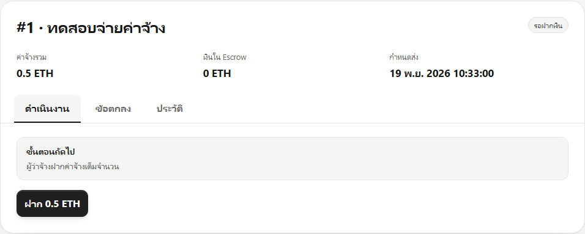

**สิ่งที่อ่านได้จากภาพ**

- หัวงานแสดงหมายเลข **#1** พร้อมชื่อโครงการ และป้ายสถานะ **รอฝากเงิน**
- ค่าจ้างที่ตกลงคือ **0.5 ETH** แต่เงินที่อยู่ใน Escrow ยังเป็น **0 ETH** เพราะการสร้างข้อตกลงกับการฝากเงินเป็นคนละธุรกรรม
- กล่องขั้นตอนถัดไประบุให้ผู้ว่าจ้างฝากค่าจ้างเต็มจำนวน และมีปุ่ม **ฝาก 0.5 ETH** สำหรับผู้ว่าจ้าง

**ผลที่ชุดทดสอบยืนยัน:** ชุดทดสอบสร้างงานผ่านหน้าเว็บ รอให้ธุรกรรมยืนยันและโหลดหัวงานได้ จากนั้นใช้ปุ่มฝากเงินของงานเดียวกันในขั้นตอนถัดไป ภาพนี้แสดงว่าข้อตกลงถูกสร้างแล้ว แต่ยังไม่ใช่หลักฐานว่ามีเงินประกันการจ่ายอยู่ในสัญญา

**ความหมายต่อการใช้งาน:** ผู้ใช้แยกได้ชัดว่าตอนนี้ตกลงจ้างแล้วหรือฝากเงินจริงแล้ว สำหรับ V1 ผู้ว่าจ้างฝากได้หลังสร้างงาน ส่วนเงื่อนไขให้ฟรีแลนซ์รับข้อตกลงก่อนฝากเป็นความสามารถของ V2

[กลับสารบัญภาพ](#สารบัญภาพทั้งหมด)

<a id="test-02"></a>

### ภาพ 02: V1 — ฝากค่าจ้างเข้า Escrow แล้ว

ไฟล์ต้นฉบับ: [`02-funded.png`](evidence/02-funded.png) · ชุดทดสอบ: [`checks/browser.cjs`](checks/browser.cjs)

**ผู้ดำเนินการ:** ผู้ว่าจ้าง

**ลำดับสถานะที่เกี่ยวข้อง:** Created → Funded

**สถานการณ์ทดสอบ:** ผู้ว่าจ้างกดฝาก **0.5 ETH** ให้กับงาน #1 เดิม และรอการยืนยันธุรกรรมก่อนที่หน้าเว็บจะเปลี่ยนสถานะ

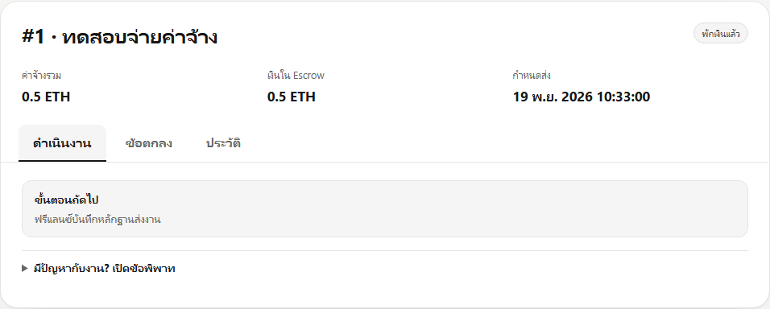

**สิ่งที่อ่านได้จากภาพ**

- ป้ายสถานะเปลี่ยนเป็น **พักเงินแล้ว**
- ยอดค่าจ้างยังเป็น **0.5 ETH** และยอดเงินใน Escrow เพิ่มเป็น **0.5 ETH** เท่ากับค่าจ้างเต็มจำนวน
- ขั้นตอนถัดไปเปลี่ยนเป็นให้ฟรีแลนซ์บันทึกหลักฐานส่งงาน
- มีหัวข้อ **มีปัญหากับงาน? เปิดข้อพิพาท** เพื่อให้คู่สัญญาส่งเรื่องให้ผู้ตัดสินตามขั้นตอน

**ผลที่ชุดทดสอบยืนยัน:** ชุดทดสอบรอให้หน้าเว็บแสดงสถานะพักเงินแล้ว และตรวจอีกแท็บหนึ่งว่ายอดพักอัปเดตเป็น 0.5 ETH โดยอัตโนมัติ จึงครอบคลุมทั้งการฝากเงินและการอ่านสถานะข้ามแท็บ

**ความหมายต่อการใช้งาน:** ค่าจ้างยังพักอยู่ในสัญญา ไม่ได้ถูกโอนให้ฟรีแลนซ์ทันที ผู้ว่าจ้างในภาพไม่เห็นฟอร์มส่งงาน เพราะฟอร์มนั้นต้องใช้สิทธิ์ของฟรีแลนซ์

[กลับสารบัญภาพ](#สารบัญภาพทั้งหมด)

<a id="test-03"></a>

### ภาพ 03: V1 — ฟรีแลนซ์ส่งหลักฐานผลงาน

ไฟล์ต้นฉบับ: [`03-submitted.png`](evidence/03-submitted.png) · ชุดทดสอบ: [`checks/browser.cjs`](checks/browser.cjs)

**ผู้ดำเนินการ:** ฟรีแลนซ์

**ลำดับสถานะที่เกี่ยวข้อง:** Funded → Submitted

**สถานการณ์ทดสอบ:** หลังมีเงินฝาก ชุดทดสอบสลับเป็นฟรีแลนซ์ กรอกหลักฐาน `https://example.com/work` และกด **บันทึกส่งงาน**

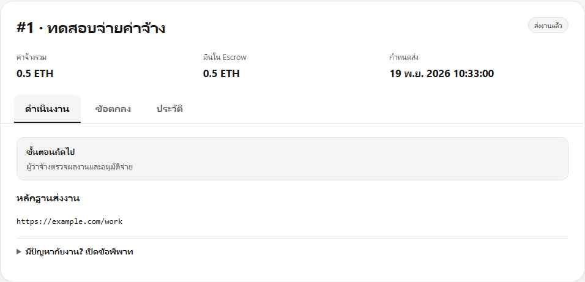

**สิ่งที่อ่านได้จากภาพ**

- ป้ายสถานะเปลี่ยนเป็น **ส่งงานแล้ว**
- หัวข้อ **หลักฐานส่งงาน** แสดง URL ที่กรอกไว้ ทำให้คู่สัญญากลับมาตรวจหลักฐานได้
- ยอด Escrow ยังคงเป็น **0.5 ETH** และยังไม่มีการจ่ายให้ฟรีแลนซ์
- ขั้นตอนถัดไประบุให้ผู้ว่าจ้างตรวจงานและอนุมัติจ่าย

**ผลที่ชุดทดสอบยืนยัน:** ชุดทดสอบรอธุรกรรมส่งงานยืนยัน ตรวจสถานะส่งงานแล้ว แล้วสลับกลับเป็นผู้ว่าจ้างเพื่อดำเนินการอนุมัติ หลักฐานตัวอย่างเป็นข้อความสำหรับทดสอบ ไม่ใช่ไฟล์ผลงานที่อัปโหลดจริง

**ความหมายต่อการใช้งาน:** การส่งงานกับการจ่ายเงินเป็นคนละขั้นตอน ระบบบันทึกจุดส่งมอบไว้ให้ตรวจย้อนหลัง แต่ไม่ตัดสินคุณภาพของผลงานแทนผู้ว่าจ้าง

[กลับสารบัญภาพ](#สารบัญภาพทั้งหมด)

<a id="test-04"></a>

### ภาพ 04: V1 — ผู้ว่าจ้างอนุมัติจ่ายและตรวจประวัติ

ไฟล์ต้นฉบับ: [`04-approved.png`](evidence/04-approved.png) · ชุดทดสอบ: [`checks/browser.cjs`](checks/browser.cjs)

**ผู้ดำเนินการ:** ผู้ว่าจ้าง

**ลำดับสถานะที่เกี่ยวข้อง:** Submitted → Paid

**สถานการณ์ทดสอบ:** ผู้ว่าจ้างตรวจงาน #1 และยืนยัน **อนุมัติและจ่าย 0.5 ETH** จากนั้นเปิดแท็บประวัติเพื่อตรวจเส้นทางธุรกรรมของงาน

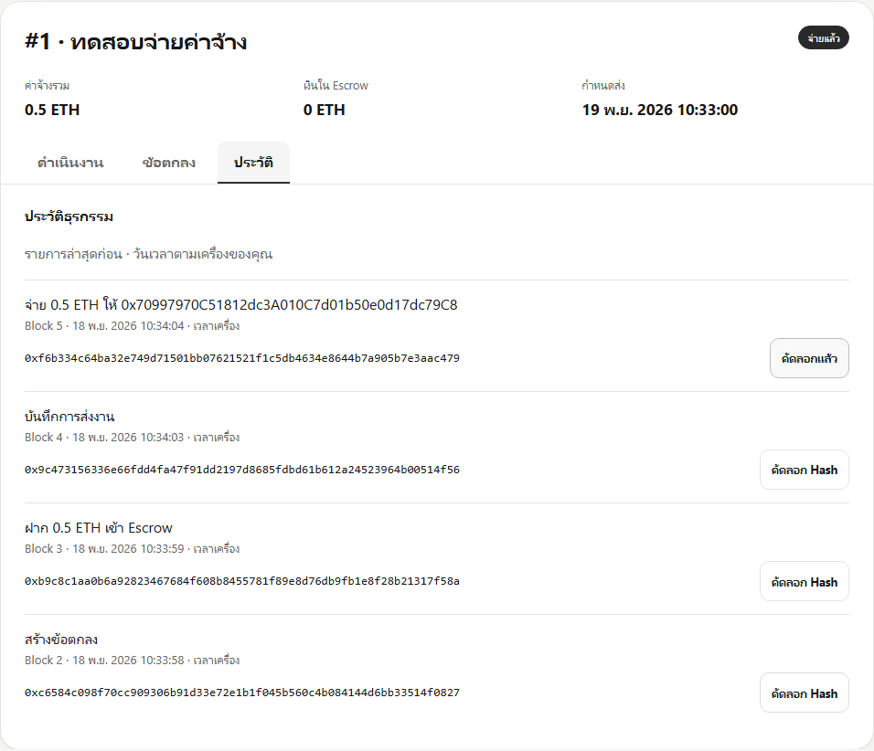

**สิ่งที่อ่านได้จากภาพ**

- สถานะงานเป็น **จ่ายแล้ว** และยอดเงินใน Escrow เป็น **0 ETH**
- รายการล่าสุดระบุว่าจ่าย **0.5 ETH** ให้ Wallet ฟรีแลนซ์
- ประวัติเรียงรายการล่าสุดก่อน และยังมีรายการส่งงาน ฝากเงิน และสร้างข้อตกลงของงานเดียวกัน
- แต่ละรายการแสดงเลข Block วันเวลา และ Transaction Hash ในภาพปุ่มของรายการจ่ายแสดง **คัดลอกแล้ว**

**ผลที่ชุดทดสอบยืนยัน:** ชุดทดสอบตรวจยอดฟรีแลนซ์เพิ่มขึ้น 0.5 ETH ตรวจว่าประวัติมี Hash ของธุรกรรมจ่ายและเวลาที่อ่านได้จริง แล้วกดคัดลอกและตรวจข้อความใน Clipboard ว่าตรงกับ Hash นั้น หลังปิดงานต้องไม่เหลือปุ่มอนุมัติจ่ายบนหน้าเว็บ

**ความหมายต่อการใช้งาน:** ตรวจได้ทั้งผลการจ่ายกับลำดับเหตุการณ์ก่อนจ่าย ภาพนี้มาจากเชน Local จึงไม่ควรนำ Hash ในภาพไปค้นบน Sepolia Etherscan; เมื่อใช้ Sepolia หน้าเว็บจึงแสดงลิงก์ Etherscan ของเครือข่ายนั้น

[กลับสารบัญภาพ](#สารบัญภาพทั้งหมด)

<a id="test-05"></a>

### ภาพ 05: V1 — ผู้ตัดสินพิจารณาแล้วสั่งจ่ายให้ฟรีแลนซ์

ไฟล์ต้นฉบับ: [`05-dispute-paid.png`](evidence/05-dispute-paid.png) · ชุดทดสอบ: [`checks/browser.cjs`](checks/browser.cjs)

**ผู้ดำเนินการ:** ฟรีแลนซ์เปิดข้อพิพาท → ผู้ว่าจ้างส่งคำชี้แจง → ผู้ตัดสินชี้ขาด

**ลำดับสถานะที่เกี่ยวข้อง:** Submitted → Disputed → Paid

**สถานการณ์ทดสอบ:** เป็นงานทดสอบอีกงานหนึ่งชื่อ **ทดสอบผู้ตัดสินสั่งจ่าย** หมายเลข #3 ฟรีแลนซ์ส่งงานแล้วและเปิดข้อพิพาทเรื่องรอชำระเงิน ผู้ว่าจ้างส่งหลักฐานตอบกลับก่อนผู้ตัดสินตัดสิน

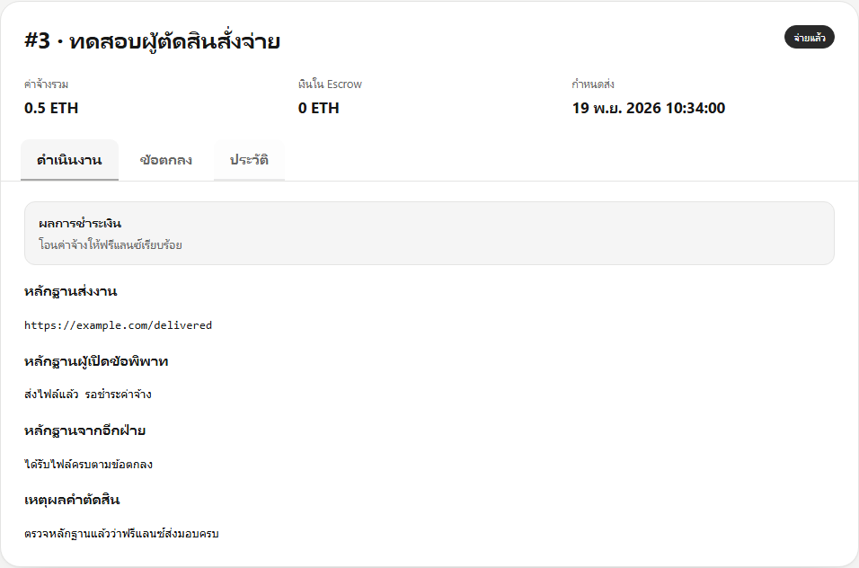

**สิ่งที่อ่านได้จากภาพ**

- สถานะสุดท้ายเป็น **จ่ายแล้ว** ค่าจ้าง **0.5 ETH** และเงินใน Escrow เป็น **0 ETH**
- หลักฐานส่งงานคือ `https://example.com/delivered`
- หลักฐานผู้เปิดข้อพิพาทระบุ **ส่งไฟล์แล้ว รอชำระค่าจ้าง** และคำชี้แจงอีกฝ่ายระบุ **ได้รับไฟล์ครบตามข้อตกลง**
- มีเหตุผลคำตัดสิน **ตรวจหลักฐานแล้วว่าฟรีแลนซ์ส่งมอบครบ** แสดงแยกจากหลักฐานของคู่สัญญา

**ผลที่ชุดทดสอบยืนยัน:** ชุดทดสอบเปิดข้อพิพาท ส่งคำชี้แจงจากอีกฝ่าย และให้บัญชีผู้ตัดสินสั่งจ่าย ตรวจยอดฟรีแลนซ์เพิ่มขึ้น 0.5 ETH ตรวจประวัติว่ามีการตัดสินสั่งจ่าย และตรวจว่าเหตุผลคำตัดสินแสดงได้

**ความหมายต่อการใช้งาน:** การจ่ายหลังข้อพิพาทต้องผ่านผู้ตัดสิน และเก็บคำชี้แจงสองฝ่ายกับเหตุผลที่ใช้ตัดสินไว้ การจ่ายปกติของผู้ว่าจ้างไม่ใช่เส้นทางเดียวกับการชี้ขาดข้อพิพาท

[กลับสารบัญภาพ](#สารบัญภาพทั้งหมด)

<a id="test-06"></a>

### ภาพ 06: V1 — ผู้ตัดสินสั่งคืนค่าจ้างให้ผู้ว่าจ้าง

ไฟล์ต้นฉบับ: [`06-dispute-refunded.png`](evidence/06-dispute-refunded.png) · ชุดทดสอบ: [`checks/browser.cjs`](checks/browser.cjs)

**ผู้ดำเนินการ:** ผู้ว่าจ้างเปิดข้อพิพาท → ฟรีแลนซ์ส่งคำชี้แจง → ผู้ตัดสินชี้ขาด

**ลำดับสถานะที่เกี่ยวข้อง:** Funded → Disputed → Refunded

**สถานการณ์ทดสอบ:** งานทดสอบหมายเลข #2 ชื่อ **ทดสอบคืนเงิน** มีเงินฝาก 0.5 ETH แล้ว แต่คู่สัญญาตกลงยุติงานก่อนส่งมอบ ผู้ว่าจ้างจึงเปิดข้อพิพาทและให้ผู้ตัดสินดำเนินการคืนเงิน

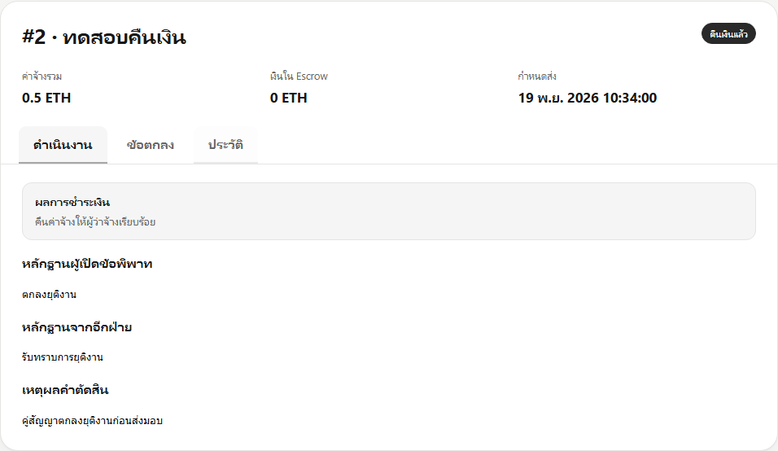

**สิ่งที่อ่านได้จากภาพ**

- ป้ายสถานะเป็น **คืนเงินแล้ว** และยอด Escrow เป็น **0 ETH**
- กล่องผลการชำระเงินระบุว่าคืนค่าจ้างให้ผู้ว่าจ้างเรียบร้อย
- เหตุผลผู้เปิดข้อพิพาทคือ **ตกลงยุติงาน** และอีกฝ่ายตอบ **รับทราบการยุติงาน**
- เหตุผลคำตัดสินคือ **คู่สัญญาตกลงยุติงานก่อนส่งมอบ**

**ผลที่ชุดทดสอบยืนยัน:** ก่อนสลับเป็นผู้ตัดสิน ชุดทดสอบตรวจว่าคู่สัญญาไม่มีปุ่มคืนให้ผู้ว่าจ้าง จากนั้นตรวจว่าการชี้ขาดทำให้ยอดผู้ว่าจ้างเพิ่มขึ้น 0.5 ETH มีรายการคืนเงินในประวัติ และแสดงเหตุผลคำตัดสิน

**ความหมายต่อการใช้งาน:** ผู้ว่าจ้างถอนเงินที่พักอยู่เองไม่ได้ การยุติงานในกรณีนี้ต้องผ่านข้อพิพาทและคำตัดสิน สำหรับ V1 การคืนเป็นการคืนค่าจ้างเต็มงาน

[กลับสารบัญภาพ](#สารบัญภาพทั้งหมด)

<a id="test-07"></a>

### ภาพ 07: V1 — ภาพรวมเดสก์ท็อปหลังจบสามเส้นทางทดสอบ

ไฟล์ต้นฉบับ: [`07-desktop.png`](evidence/07-desktop.png) · ชุดทดสอบ: [`checks/browser.cjs`](checks/browser.cjs)

**ผู้ดำเนินการ:** ผู้ตัดสิน

**ลำดับสถานะที่เกี่ยวข้อง:** งาน #1 Paid / งาน #2 Refunded / งาน #3 Paid

**สถานการณ์ทดสอบ:** ภาพเต็มหน้าจอหลังทดสอบจ่ายปกติ คืนเงินผ่านข้อพิพาท และสั่งจ่ายผ่านข้อพิพาทครบแล้ว ใช้จอเดสก์ท็อปกว้าง 1360 พิกเซล

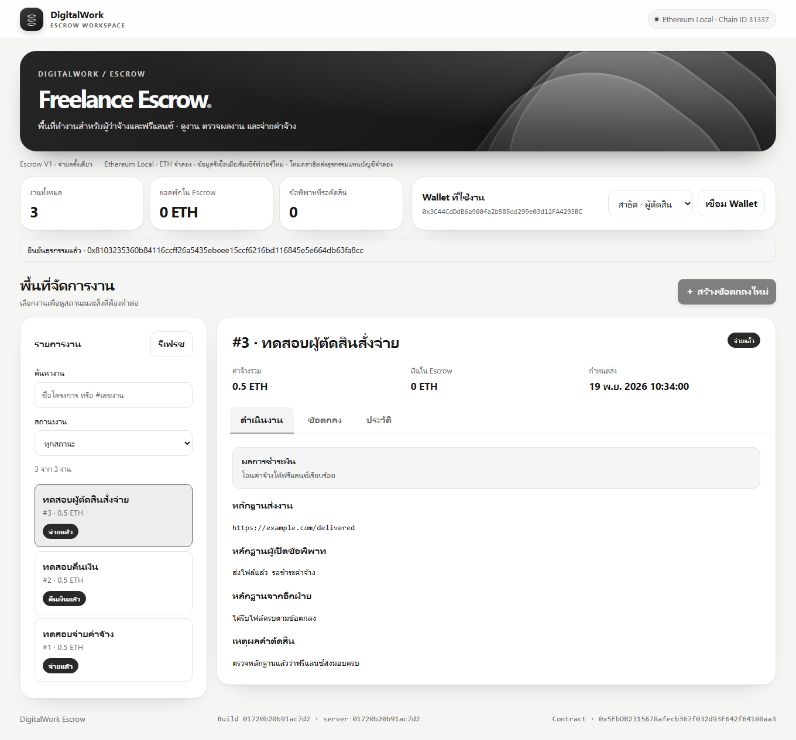

**สิ่งที่อ่านได้จากภาพ**

- การ์ดภาพรวมแสดง **3 งาน**, ยอดพักรวม **0 ETH** และข้อพิพาทที่รอตัดสิน **0**
- ด้านซ้ายมีช่องค้นหา ตัวกรองสถานะ และรายการทั้งสามงานพร้อมป้ายสถานะที่ต่างกัน
- ด้านขวาเปิดงาน #3 และแสดงหลักฐานส่งงาน หลักฐานคู่สัญญา และเหตุผลคำตัดสินครบ
- Wallet สาธิตเลือกบทบาท **ผู้ตัดสิน** จึงเห็นปุ่มสร้างข้อตกลงเป็นสีจางและใช้งานไม่ได้ตามสิทธิ์

**ผลที่ชุดทดสอบยืนยัน:** เมื่อจบทั้งสามเส้นทาง ชุดทดสอบตรวจยอดคงเหลือจริงของสัญญาเป็นศูนย์และยอดพักรวมบนหน้าเว็บเป็น 0 ETH ไม่ได้อ่านเฉพาะป้ายสถานะของงานที่เลือก

**ความหมายต่อการใช้งาน:** ยอดด้านบนเป็นภาพรวมของทุกงาน ส่วนค่าจ้างและหลักฐานด้านขวาเป็นข้อมูลของงานที่เลือก การปิดงานหนึ่งต้องไม่ทำให้ยอดของงานอื่นผิดพลาด

[กลับสารบัญภาพ](#สารบัญภาพทั้งหมด)

<a id="test-08"></a>

### ภาพ 08: V1 — รายละเอียดข้อพิพาทบนหน้าจอมือถือ

ไฟล์ต้นฉบับ: [`08-mobile.png`](evidence/08-mobile.png) · ชุดทดสอบ: [`checks/browser.cjs`](checks/browser.cjs)

**ผู้ดำเนินการ:** ผู้ตัดสิน

**ลำดับสถานะที่เกี่ยวข้อง:** งาน #3 Paid

**สถานการณ์ทดสอบ:** เปลี่ยนหน้าจอของข้อมูลชุดเดียวกับภาพ 07 เป็น **375 × 850 พิกเซล** ภาพเป็นการจับทั้งหน้า จึงมีความสูงมากกว่า 850 พิกเซล

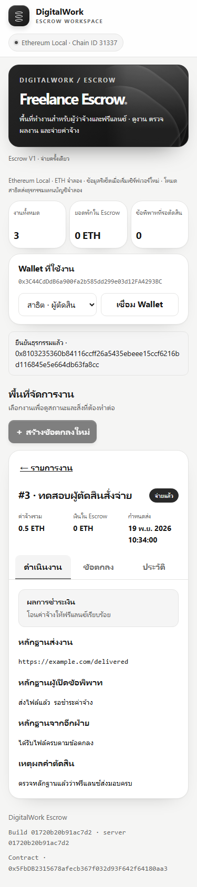

**สิ่งที่อ่านได้จากภาพ**

- การ์ด Wallet ปุ่ม และรายละเอียดงานจัดเรียงลงด้านล่างให้เหมาะกับพื้นที่แคบ
- มีปุ่ม **← รายการงาน** เพื่อกลับไปเลือกงานอื่น แทนการแสดงรายการกับรายละเอียดเคียงกัน
- ชื่อโครงการ กำหนดส่ง Transaction Hash และ Address ตัดบรรทัดได้
- หลักฐานผู้เปิดข้อพิพาท คำชี้แจงอีกฝ่าย และเหตุผลคำตัดสินยังอ่านได้ครบเหมือนเดสก์ท็อป

**ผลที่ชุดทดสอบยืนยัน:** ชุดทดสอบตรวจว่าไม่มีการล้นแนวนอน จากนั้นกลับรายการ เลือกตัวกรองคืนเงินแล้ว ตรวจว่าเหลืองานเดียว และเปิดงานนั้นได้ รวมถึงเปิดหน้าสร้างงานแล้วใช้ Escape ปิดและคืนโฟกัสให้ปุ่มเดิม

**ความหมายต่อการใช้งาน:** การปรับหน้าจอเปลี่ยนวิธีจัดพื้นที่ แต่ยังเข้าถึงงานและรายละเอียดสำคัญได้ ภาพนี้เป็นการจำลองขนาดจอในเบราว์เซอร์ ไม่ใช่การทดสอบทุกอุปกรณ์จริง

[กลับสารบัญภาพ](#สารบัญภาพทั้งหมด)

<a id="test-09"></a>

### ภาพ 09: Wallet — สร้างงานด้วยธุรกรรมที่ลงนามผ่าน EIP-1193

ไฟล์ต้นฉบับ: [`09-wallet-signed.png`](evidence/09-wallet-signed.png) · ชุดทดสอบ: [`checks/wallet.cjs`](checks/wallet.cjs)

**ผู้ดำเนินการ:** ผู้ว่าจ้างเชื่อม Wallet จำลอง

**ลำดับสถานะที่เกี่ยวข้อง:** V2 Created → รอรับข้อตกลง

**สถานการณ์ทดสอบ:** รันทดสอบโหมด Wallet กับ V2 บน Hardhat Local โดยใช้ตัวเชื่อม EIP-1193 จำลองและบัญชี Hardhat ลงนามธุรกรรม ชุดทดสอบนี้ไม่ได้เลือกบทบาทจากเมนูสาธิตบนหน้าเว็บ

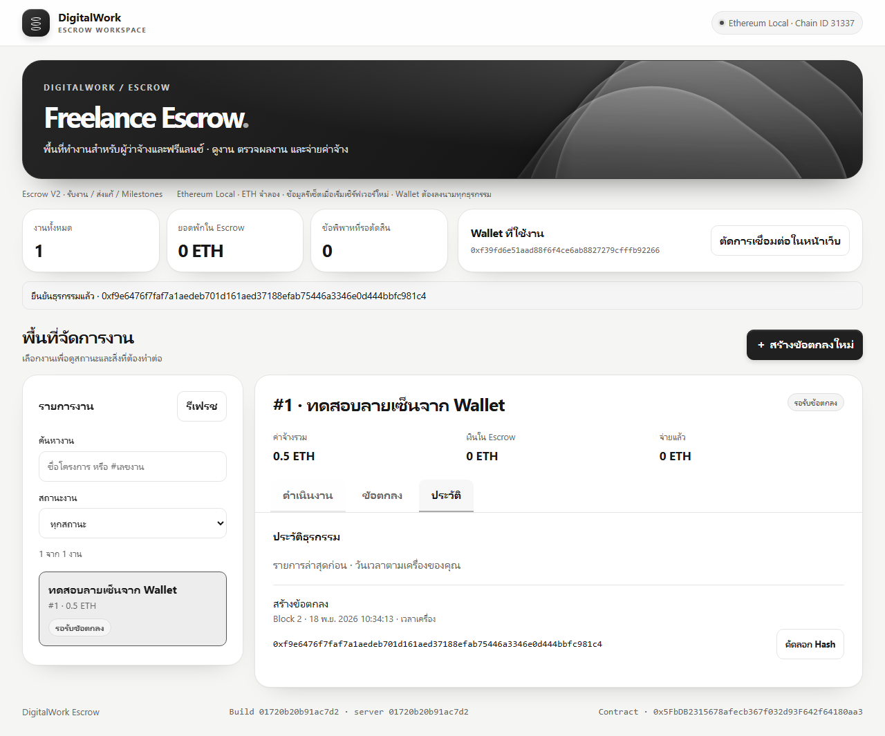

**สิ่งที่อ่านได้จากภาพ**

- มี Wallet ที่เชื่อมอยู่และปุ่ม **ตัดการเชื่อมต่อในหน้าเว็บ** แทนเมนูสลับบทบาทสาธิต
- แถบแจ้งผลระบุ **ยืนยันธุรกรรมแล้ว** พร้อม Transaction Hash
- งาน **ทดสอบลายเซ็นจาก Wallet** แสดงในรายการ และแท็บประวัติมีเหตุการณ์สร้างข้อตกลง
- ค่าจ้างของงานคือ **0.5 ETH** แต่ยอด Escrow และยอดจ่ายเป็น **0 ETH** เพราะยังอยู่ในสถานะรอฟรีแลนซ์รับข้อตกลง

**ผลที่ชุดทดสอบยืนยัน:** ชุดทดสอบลองยกเลิกใน Wallet และจำลองข้อผิดพลาด RPC ซ้อนก่อน โดยตรวจว่าจำนวนธุรกรรมไม่เพิ่ม จากนั้นส่งรายการสำเร็จและตรวจ Receipt ว่า status = 1 ผู้ส่งตรงกับผู้ว่าจ้าง และมี Event JobCreated ของสัญญานี้ ชุดทดสอบเดียวกันผ่านทั้ง V1 และ V2; ไฟล์ภาพนี้เป็นผลรอบ V2

**ความหมายต่อการใช้งาน:** การแสดง Hash บนหน้าเว็บมีการตรวจประกอบด้วย Receipt และ Event ไม่ใช่เพียงข้อความแจ้งสำเร็จ ภาพนี้ยังไม่ใช่หลักฐานการกดยืนยันผ่าน MetaMask Extension บน Sepolia

[กลับสารบัญภาพ](#สารบัญภาพทั้งหมด)

<a id="test-10"></a>

### ภาพ 10: V2 — ผู้ว่าจ้างตรวจผลงานงวดแรกก่อนอนุมัติ

ไฟล์ต้นฉบับ: [`10-v2-review.png`](evidence/10-v2-review.png) · ชุดทดสอบ: [`checks/milestones.cjs`](checks/milestones.cjs)

**ผู้ดำเนินการ:** ผู้ว่าจ้าง

**ลำดับสถานะที่เกี่ยวข้อง:** Accepted → Funded → Submitted ของงวดที่ 1

**สถานการณ์ทดสอบ:** งาน **งานส่งแก้และจ่ายครบ** แบ่งเป็น 3 งวด: ออกแบบ 0.02 ETH, พัฒนา 0.03 ETH และส่งมอบ 0.05 ETH ฟรีแลนซ์รับข้อตกลง ผู้ว่าจ้างฝากครบ **0.1 ETH** จากนั้นฟรีแลนซ์ส่งหลักฐานงวดแรกและรอผู้ว่าจ้างตรวจ

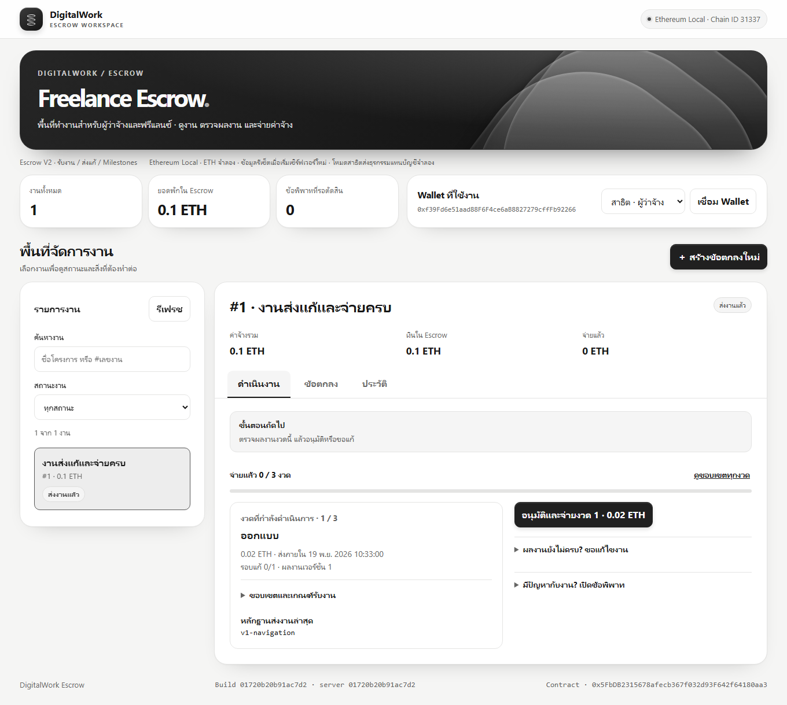

**สิ่งที่อ่านได้จากภาพ**

- ยอดรวมค่าจ้าง **0.1 ETH**, เงินใน Escrow **0.1 ETH** และยอดจ่ายสะสม **0 ETH**
- ส่วนงวดปัจจุบันระบุ **1 / 3**, ชื่องวด **ออกแบบ** และหลักฐานล่าสุด `v1-navigation`
- แสดงรอบแก้ **0/1** กับผลงานเวอร์ชัน **1** โดยตัวเลขนี้เป็นเวอร์ชันของผลงาน ไม่ใช่เวอร์ชันของ Smart Contract
- ปุ่มอนุมัติจ่ายระบุ **0.02 ETH** ของงวดแรก และมีหัวข้อขอแก้กับเปิดข้อพิพาทแยกไว้ด้านข้าง

**ผลที่ชุดทดสอบยืนยัน:** ก่อนถึงภาพนี้ ชุดทดสอบตรวจว่าฝากไม่ได้ก่อนรับข้อตกลง จากนั้นตรวจสถานะหลังรับงาน ฝากเงิน และส่งผลงาน รวมทั้งตรวจว่าปุ่มอนุมัติอยู่ในพื้นที่มองเห็นของจอเดสก์ท็อปที่ใช้ทดสอบ

**ความหมายต่อการใช้งาน:** ผู้ว่าจ้างฝากเงินครบโครงการเพื่อประกันการชำระ แต่การอนุมัติแต่ละครั้งจ่ายเฉพาะงวดปัจจุบัน จึงยังเหลือเงินของงวดถัดไปใน Escrow

[กลับสารบัญภาพ](#สารบัญภาพทั้งหมด)

<a id="test-11"></a>

### ภาพ 11: V2 — ประวัติรับงาน ส่งแก้ และจ่ายครบทั้งสามงวด

ไฟล์ต้นฉบับ: [`11-v2-revision-history.png`](evidence/11-v2-revision-history.png) · ชุดทดสอบ: [`checks/milestones.cjs`](checks/milestones.cjs)

**ผู้ดำเนินการ:** ผู้ว่าจ้างเปิดประวัติ หลังคู่สัญญาดำเนินงานครบ

**ลำดับสถานะที่เกี่ยวข้อง:** Submitted → RevisionRequested → Submitted → Paid ตามลำดับงวด

**สถานการณ์ทดสอบ:** ต่อจากภาพ 10 ผู้ว่าจ้างขอแก้ **แก้เมนูให้ตรงข้อตกลง** หนึ่งรอบ ฟรีแลนซ์ส่ง `v2-navigation-fixed` แล้วจึงจ่ายงวดแรก จากนั้นส่งและจ่ายงวด 2 กับ 3 ตามลำดับ ภาพนี้เป็นงาน #1 ที่จ่ายครบด้วยการอนุมัติปกติ

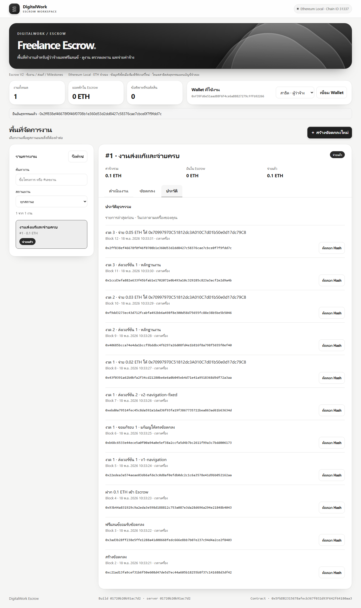

**สิ่งที่อ่านได้จากภาพ**

- สถานะสุดท้าย **จ่ายแล้ว**, ยอดจ่ายสะสม **0.1 ETH** และ Escrow **0 ETH**
- ประวัติเรียงใหม่ไปเก่า จึงเห็นการจ่ายงวด 3 ก่อนรายการก่อนหน้านั้น
- พบทั้งรายการส่งเวอร์ชัน 1 `v1-navigation`, การขอแก้รอบ 1 และการส่งเวอร์ชัน 2 `v2-navigation-fixed` ของงวดแรก
- ยังเห็นการรับข้อตกลง ฝาก 0.1 ETH และจ่ายรายงวด **0.02 / 0.03 / 0.05 ETH** พร้อมเลข Block เวลา และ Hash ของแต่ละธุรกรรม

**ผลที่ชุดทดสอบยืนยัน:** หลังขอแก้ ชุดทดสอบตรวจว่าสถานะเป็นรอแก้และยังไม่มียอดจ่าย เมื่อส่งใหม่แล้วใช้รอบแก้ครบต้องไม่มีปุ่มขอแก้อีก จากนั้นตรวจยอดจ่ายและ Escrow หลังงวดแรก ตรวจว่าจ่ายครบแล้วปิดงาน และตรวจว่าประวัติอ่านหลักฐานทั้งสองเวอร์ชันได้ ชุดทดสอบ Contract แยกตรวจการปฏิเสธอนุมัติจากเวอร์ชันเก่า

**ความหมายต่อการใช้งาน:** การส่งใหม่ไม่ทำให้หลักฐานเวอร์ชันก่อนหน้าหายไปจาก Event คู่สัญญาจึงไล่ตรวจว่าแก้อะไร ส่งเวอร์ชันใด และจ่ายหลังเหตุการณ์ใดได้

[กลับสารบัญภาพ](#สารบัญภาพทั้งหมด)

<a id="test-12"></a>

### ภาพ 12: V2 — ข้อพิพาทคืนเฉพาะยอดที่ยังไม่จ่าย

ไฟล์ต้นฉบับ: [`12-v2-refund.png`](evidence/12-v2-refund.png) · ชุดทดสอบ: [`checks/milestones.cjs`](checks/milestones.cjs)

**ผู้ดำเนินการ:** ผู้ว่าจ้างเปิดข้อพิพาท → ฟรีแลนซ์ตอบกลับ → ผู้ตัดสินคืนเงิน

**ลำดับสถานะที่เกี่ยวข้อง:** จ่ายงวดแรกแล้ว → Disputed ของงวดถัดไป → Refunded

**สถานการณ์ทดสอบ:** สร้างงาน #2 ชื่อ **งานคืนเฉพาะยอดที่เหลือ** ด้วยค่าจ้างรวม 0.1 ETH เช่นเดียวกับตัวอย่างก่อนหน้า หลังจ่ายงวดแรก **0.02 ETH** แล้ว คู่สัญญาเปิดข้อพิพาทของงวดที่กำลังดำเนินการ และผู้ตัดสินเลือกคืนยอดที่พักอยู่ทั้งหมดเพื่อปิดงาน

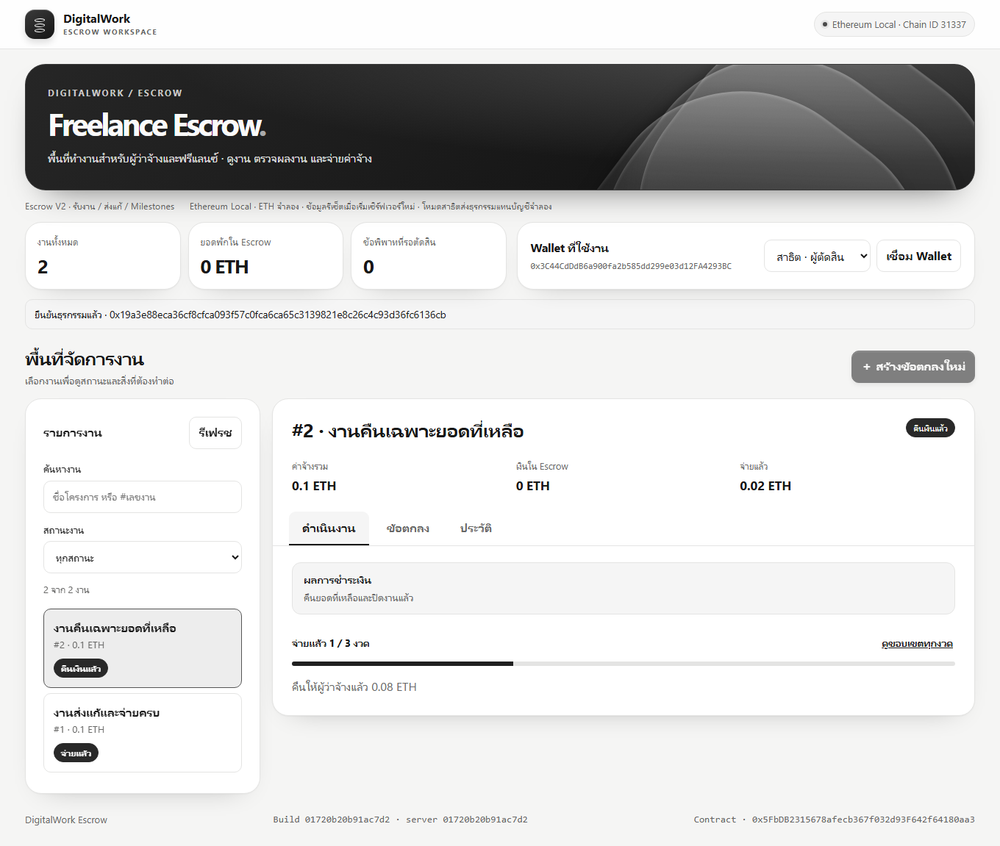

**สิ่งที่อ่านได้จากภาพ**

- ป้ายงานเป็น **คืนเงินแล้ว** แต่ยอด **จ่ายแล้ว** ยังเป็น **0.02 ETH**
- แถบความคืบหน้าแสดงว่าจ่ายสำเร็จ **1 / 3 งวด**
- ข้อความด้านล่างระบุ **คืนให้ผู้ว่าจ้างแล้ว 0.08 ETH** และ Escrow เหลือ **0 ETH**
- ยอดในภาพสอดคล้องกัน: **0.1 = 0.02 จ่ายแล้ว + 0.08 คืนแล้ว + 0 คงพัก**

**ผลที่ชุดทดสอบยืนยัน:** ชุดทดสอบอ่านสถานะและยอดจาก Contract โดยตรวจ paidWei = 0.02 ETH, refundedWei = 0.08 ETH, escrowWei = 0 และสถานะปิดแบบคืนเงิน นอกจากนี้ตรวจว่างวดที่ยังไม่จ่ายทั้งสองงวดแสดงสถานะคืนเงินแล้ว

**ความหมายต่อการใช้งาน:** การคืนเงินหลังมีการจ่ายบางงวดไม่ย้อนเอาเงินงวดที่จ่ายสำเร็จกลับมา ผู้ว่าจ้างได้รับคืนเฉพาะเงินที่ยังพักอยู่ และงานที่ปิดแล้วไม่ดำเนินงวดที่เหลือต่อ

[กลับสารบัญภาพ](#สารบัญภาพทั้งหมด)

<a id="test-13"></a>

### ภาพ 13: V2 — ผู้ตัดสินสั่งจ่ายงวดที่พิพาทแล้วทำงานต่อจนจบ

ไฟล์ต้นฉบับ: [`13-v2-completed.png`](evidence/13-v2-completed.png) · ชุดทดสอบ: [`checks/milestones.cjs`](checks/milestones.cjs)

**ผู้ดำเนินการ:** ผู้ตัดสินสั่งจ่ายงวดแรก → ฟรีแลนซ์ส่งงวดต่อไป → ผู้ว่าจ้างอนุมัติ

**ลำดับสถานะที่เกี่ยวข้อง:** Disputed → Funded ของงวดถัดไป → Paid เมื่อครบทุกงวด

**สถานการณ์ทดสอบ:** เป็นงาน #3 ชื่อ **งานผู้ตัดสินสั่งจ่ายงวด** เพื่อทดสอบผลชี้ขาดอีกแบบ ผู้ตัดสินจ่ายเฉพาะงวดที่พิพาท 0.02 ETH ก่อน จากนั้นคู่สัญญาทำงวด 2 และ 3 ต่อและจ่ายครบ ภาพนี้ต่างจากงานส่งแก้ #1 ในภาพ 11

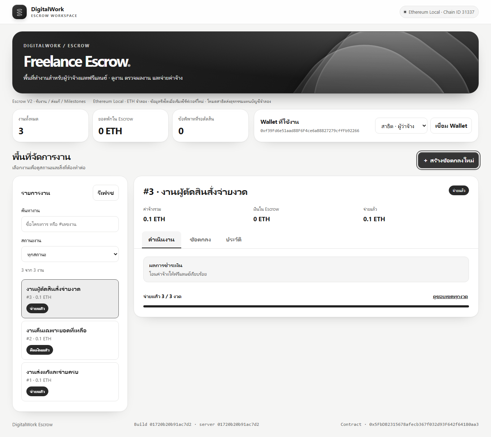

**สิ่งที่อ่านได้จากภาพ**

- งานที่เลือกแสดงค่าจ้าง **0.1 ETH**, ยอดจ่ายสะสม **0.1 ETH** และยอด Escrow **0 ETH**
- สถานะเป็น **จ่ายแล้ว** กล่องผลการชำระเงินระบุว่าโอนให้ฟรีแลนซ์เรียบร้อย
- ความคืบหน้าเต็ม **3 / 3 งวด** และยังเปิดขอบเขตทุกงวดจากแท็บข้อตกลงได้
- รายการด้านซ้ายมีงานครบสามกรณี: งานจ่ายหลังส่งแก้ งานคืนยอดที่เหลือ และงานที่ผู้ตัดสินสั่งจ่ายงวดแรก ส่วนยอดพักรวมและข้อพิพาทรอตัดสินเป็นศูนย์

**ผลที่ชุดทดสอบยืนยัน:** หลังคำตัดสิน ชุดทดสอบตรวจว่าจ่ายแล้ว 0.02 ETH ยังพัก 0.08 ETH และ currentMilestone เลื่อนไปงวดถัดไป จากนั้นส่งและจ่าย 0.03 กับ 0.05 ETH ต่อได้จนสถานะ Paid พร้อมตรวจยอด ETH คงเหลือจริงของสัญญาเป็นศูนย์

**ความหมายต่อการใช้งาน:** การตัดสินจ่ายงวดที่พิพาทใน V2 ไม่จำเป็นต้องปิดทั้งโครงการ แต่การคืนยอดที่เหลือในภาพ 12 จะปิดงาน ความแตกต่างนี้ทำให้การชำระเงินตรงกับขอบเขตของแต่ละงวด

[กลับสารบัญภาพ](#สารบัญภาพทั้งหมด)

<a id="test-14"></a>

### ภาพ 14: V2 — ภาพรวมงานที่จบแล้วบนมือถือ

ไฟล์ต้นฉบับ: [`14-v2-mobile.png`](evidence/14-v2-mobile.png) · ชุดทดสอบ: [`checks/milestones.cjs`](checks/milestones.cjs)

**ผู้ดำเนินการ:** ผู้ว่าจ้าง

**ลำดับสถานะที่เกี่ยวข้อง:** งาน #3 Paid

**สถานการณ์ทดสอบ:** ใช้ข้อมูลเดียวกับภาพ 13 แต่ปรับหน้าจอเป็น **375 × 850 พิกเซล** และจับภาพเต็มหน้า เพื่อดูว่าการสรุปงานรายงวดยังใช้งานได้บนจอแคบ

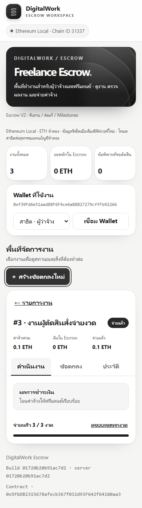

**สิ่งที่อ่านได้จากภาพ**

- ส่วนรายละเอียดเปิดงานเดียว พร้อมปุ่ม **← รายการงาน** ด้านบน
- ค่าจ้างรวม **0.1 ETH**, Escrow **0 ETH** และยอดจ่ายแล้ว **0.1 ETH** ยังแสดงครบ
- แท็บ **ดำเนินงาน / ข้อตกลง / ประวัติ** อยู่ในพื้นที่หน้าจอ และความคืบหน้ายังแสดง **3 / 3 งวด**
- งานที่จบแล้วแสดงผลชำระเงินแบบกระชับ ส่วนขอบเขตกับประวัติเปิดอ่านแยกได้

**ผลที่ชุดทดสอบยืนยัน:** ชุดทดสอบตรวจไม่มีการล้นแนวนอน กดกลับรายการแล้วต้องเห็นรายการงาน เมื่อเลือกงานใหม่ต้องซ่อนรายการและเปิดรายละเอียดได้ รวมถึงเปิด Dialog สร้างงานแล้วตรวจว่าไม่ล้น ปิดด้วย Escape ได้ และไม่มี JavaScript page error ในเส้นทางทดสอบ

**ความหมายต่อการใช้งาน:** ผู้ใช้มือถือเข้าถึงข้อมูลเดียวกับเดสก์ท็อปผ่านการเปิดทีละงานและแท็บ การจับภาพเต็มหน้าทำให้ไฟล์ยาวกว่าความสูง viewport โดยไม่หมายถึงการล้นแนวนอน

[กลับสารบัญภาพ](#สารบัญภาพทั้งหมด)

### การเก็บและอัปเดตหลักฐาน

เก็บภาพต้นฉบับทั้ง 14 ไฟล์ใน [`evidence/`](evidence/) พร้อม Commit เพื่อให้ GitHub แสดงภาพจากลิงก์สัมพัทธ์ใน README ได้ครบ โฟลเดอร์นี้ไม่ได้ถูก `.gitignore` ยกเว้น ส่วนไฟล์ลับ `.env`, Dependency, Cache, Log และผล Build ยังคงถูกยกเว้น

เมื่อรันทดสอบด้วย `CHECK_SCREENSHOTS=1` โปรแกรมจะบันทึกภาพทับชื่อเดิมตามขั้นตอนเดิม ภาพ 01–08 มาจาก `test:web`, ภาพ 09 มาจาก `test:wallet` และภาพ 10–14 มาจาก `test:web:v2` ให้ตรวจคำอธิบายและยอดเงินกับภาพใหม่ก่อน Commit ทุกครั้ง หากต้องการภาพ 09 เป็น V2 ตามหน้านี้ ให้รันทดสอบ Wallet ของ V2 เป็นรอบสุดท้าย

ตัวอย่างไฟล์ใน [`checks/`](checks/) เป็นที่มาของการทดสอบหน้าเว็บ ส่วนเงื่อนไข Contract ตรวจเพิ่มใน [`test/escrow.cjs`](test/escrow.cjs), [`test/milestones.cjs`](test/milestones.cjs) และ [`test/sepolia-attachment.cjs`](test/sepolia-attachment.cjs) วิธีเปิดเดโมและรันชุดทดสอบอยู่ในหัวข้อด้านล่าง


## การใช้งานพื้นที่จัดการงาน

ค้นหาจากชื่อโครงการหรือเลขงาน และกรองสถานะในรายการด้านซ้าย เมื่อเลือกงาน หน้ารายละเอียดแบ่งเป็นสามแท็บ:

- **ดำเนินงาน** แสดงยอดเงิน ขั้นตอนถัดไป งวดปัจจุบัน และปุ่มที่บัญชีของคุณมีสิทธิ์ใช้ ฟอร์มขอแก้และเปิดข้อพิพาทกดเปิดจากหัวข้อใต้การดำเนินการหลัก
- **ข้อตกลง** แสดงรายละเอียดโครงการ คู่สัญญา และทุกงวด กดชื่องวดเพื่ออ่านขอบเขต กำหนดส่ง และหลักฐาน ก่อนรับงานควรตรวจทุกงวดในแท็บนี้
- **ประวัติ** โหลดเมื่อเปิดแท็บ เรียงรายการล่าสุดก่อน ครั้งละ 20 รายการ พร้อมวันเวลา คัดลอก Hash และลิงก์ Etherscan บน Sepolia

บนมือถือ เลือกงานแล้วดูรายละเอียดทีละงาน กด **← รายการงาน** เพื่อกลับไปค้นหาหรือเลือกงานอื่น ใช้ปุ่มลูกศรซ้าย/ขวา หรือ Home/End เพื่อสลับแท็บด้วยคีย์บอร์ดได้


## Escrow V2 — รับข้อตกลง ส่งแก้ และจ่ายรายงวด

V2 ใช้ Contract `FreelanceEscrowV2` สำหรับงานใหม่ โดยแยกข้อมูล Deploy ไว้ใน `deployments/sepolia-v2.json` งาน V1 ใช้ `deployments/sepolia.json` และสัญญาเดิมต่อได้

### ทดลองบนเครื่อง

```powershell
Set-Location -LiteralPath 'D:\csi301\assi8'
npm.cmd run compile
npm.cmd run start:demo:v2
```

เปิด URL ที่เทอร์มินัลพิมพ์ สลับบทบาทสาธิตได้เหมือนเดิม หากพอร์ตเริ่มต้นถูกใช้งาน ให้ปิดเซิร์ฟเวอร์เดิมในเทอร์มินัลนั้นด้วย Ctrl+C หรือกำหนด `PORT` เป็นพอร์ตว่าง

1. ผู้ว่าจ้างสร้างโครงการ กำหนด 1–12 งวด แต่ละงวดมีชื่อ ขอบเขตและเกณฑ์รับงาน ค่าจ้าง ETH กำหนดส่ง และจำนวนรอบแก้ 0–10 รอบ กำหนดส่งเรียงตามลำดับงวด
2. ฟรีแลนซ์ตรวจข้อตกลงและทุกงวด แล้วกด **ยอมรับข้อตกลงและรับงาน** ก่อนกำหนดส่งงวดแรก ข้อตกลงที่สร้างแล้วแก้ค่าจ้าง ขอบเขต หรือจำนวนรอบแก้ไม่ได้
3. ผู้ว่าจ้างฝาก ETH เต็มค่าจ้างรวมหลังฟรีแลนซ์รับงาน และก่อนกำหนดส่งงวดแรก
4. ฟรีแลนซ์ส่งหลักฐานงวดแรก ผู้ว่าจ้างอนุมัติจ่ายเฉพาะงวดนั้น หรือขอแก้ตามจำนวนรอบที่ตกลง การขอแก้ต้องให้กำหนดส่งที่ไม่สั้นกว่าเดิม อยู่ในอนาคต และก่อนงวดถัดไป
5. ฟรีแลนซ์ส่งเวอร์ชันใหม่ ผู้ว่าจ้างอนุมัติได้เฉพาะเวอร์ชันล่าสุด เมื่องวดหนึ่งจ่ายแล้วจึงทำงวดถัดไป งานเสร็จเมื่อจ่ายครบทุกงวด

แต่ละการส่งงานและขอแก้ถูกบันทึกใน Event พร้อมหมายเลขงวด เวอร์ชัน หลักฐาน และเหตุผล หน้าเว็บแสดงเวอร์ชันล่าสุดและประวัติทั้งหมด

เมื่อมีข้อพิพาท จะระงับการส่งงาน แก้ไข และอนุมัติปกติ ผู้ตัดสินเลือกจ่ายเฉพาะงวดที่พิพาทแล้วทำงวดถัดไป หรือคืนยอดที่ยังพักอยู่ทั้งหมดและปิดงาน งวดที่จ่ายแล้วคงผลการจ่ายไว้ ยอดจ่ายสะสม + ยอดพัก + ยอดคืน เท่ากับค่าจ้างรวมของงานที่ฝากแล้ว ผู้ตัดสินยังถูกกำหนดถาวร ไม่มีเส้นตายตัดสิน

### ใช้ V2 บน Sepolia

```powershell
npm.cmd run setup:sepolia:v2
```

อ่านหน้าตั้งค่า V2 ตรวจบทบาททั้งสาม แล้ว Deploy ผ่าน MetaMask บน Sepolia ให้เซิร์ฟเวอร์รอ Receipt สองบล็อกและบันทึก `deployments/sepolia-v2.json` เมื่อเสร็จหน้าเว็บเปลี่ยนเป็น Escrow V2 ใช้ `npm.cmd run start:v2` เปิดสัญญาเดิมของ V2 ในครั้งถัดไป ส่วน `npm.cmd start` เปิดงาน V1

`npm run build:pages` เผยแพร่ V1 ที่ URL เดิม เมื่อมี manifest ของ V2 ที่ยืนยันแล้วจะเพิ่มหน้า `/v2/` พร้อมลิงก์สลับไปมา ให้ commit manifest V2 พร้อมโค้ดก่อน push การเริ่มเว็บและการ build ไม่ส่งธุรกรรม Deploy

### ตรวจ V2 ก่อน Deploy

```powershell
npm.cmd test
npm.cmd run test:pages
```

เปิดเดโม V2 ในเทอร์มินัลหนึ่งแล้วรัน `npm.cmd run test:web:v2` ในอีกเทอร์มินัล ชุดทดสอบเว็บต้องใช้เดโมที่เพิ่งเริ่ม โดยจะสร้างงานทดสอบ 3 งานและตรวจรับงาน ส่งแก้ จ่ายครบ 3 งวด และข้อพิพาททั้งสองผลลัพธ์ ปุ่ม UI ใช้ชุดข้อมูล ETH จำลอง ส่วนการทดสอบบน Sepolia จริงต้องมี Wallet เซ็นรายการ

ตั้ง `$env:CHECK_SCREENSHOTS = '1'` ก่อนรัน `npm.cmd run test:web:v2` เพื่อสร้างภาพ V2 หมายเลข 10–14 ใน `evidence/` ส่วน `test:web` สร้างภาพ V1 หมายเลข 01–08 และ `test:wallet` สร้างภาพ 09 เมื่อเปิดโหมดบันทึกภาพ ควรรัน Wallet V2 เป็นรอบสุดท้ายหากต้องการภาพ 09 ให้ตรงกับตัวอย่างใน README


Smart Contract บน Ethereum สำหรับสร้างข้อตกลง ฝาก ETH ส่งหลักฐาน อนุมัติจ่าย และจัดการข้อพิพาท หน้าเว็บแสดงเหตุการณ์บนเชนพร้อมวันเวลา เลข Block และ Transaction Hash ที่คัดลอกได้

## เผยแพร่เว็บบน GitHub Pages

1. เปิด **Settings → Pages** ของ repository แล้วเลือก **Build and deployment → Source → GitHub Actions**
2. Commit และ push ไฟล์ workflow พร้อมโค้ดไปที่ `master` หรือเปิด **Actions → Deploy Escrow to GitHub Pages → Run workflow** หากไฟล์อยู่บน `master` แล้ว
3. เมื่อ job `deploy` ผ่าน เปิด URL ที่แสดงใน **Settings → Pages** หรือในผลของ workflow สำหรับ repository นี้คือ [FreelanceSmartPlatform](https://nopparatcsi.github.io/FreelanceSmartPlatform/)

`npm run build:pages` สร้างไฟล์ใน `dist-pages/` จากโค้ดหน้าเว็บและ `deployments/sepolia.json` หน้าเว็บที่เผยแพร่อ่าน Sepolia ผ่าน PublicNode และให้ MetaMask ลงนามด้วยบัญชีของผู้ใช้ ระบบใช้สัญญาที่บันทึกไว้ใน manifest การเผยแพร่หน้าเว็บจึงใช้ประวัติงานเดิมต่อได้

## เปิดระบบบน Windows

ใช้ Node.js 20 ขึ้นไป เปิด PowerShell แล้วรัน

```powershell
Set-Location -LiteralPath 'D:\csi301\assi8'
npm.cmd ci
npm.cmd run start:demo
```

เปิด URL ที่เทอร์มินัลพิมพ์ ค่าเริ่มต้นคือ [http://127.0.0.1:8787/](http://127.0.0.1:8787/) หากพอร์ตถูกใช้งาน ให้กำหนด `$env:PORT = '8790'` ก่อนรัน

| คำสั่ง | ผู้ลงนาม |
| --- | --- |
| `npm.cmd run start:demo` | เลือกบัญชีสาธิตบนหน้าเว็บ เซิร์ฟเวอร์ส่งธุรกรรมแทนบัญชี Hardhat ทั้งสามและจำกัดปลายทางเป็น Escrow |
| `npm.cmd run start:local` | แต่ละฝ่ายลงนามใน Wallet Extension บน Hardhat Local |
| `npm.cmd start` | แต่ละฝ่ายลงนามใน Wallet Extension บน Sepolia ที่ Deploy ไว้แล้ว |

คำสั่ง `start:demo` และ `start:local` รัน **Hardhat Ethereum Local (Chain ID 31337)** ด้วย ETH จำลอง เก็บสถานะในหน่วยความจำ และ Deploy Contract ใหม่เมื่อเริ่มเซิร์ฟเวอร์ งานและประวัติของรอบก่อนจึงหายไป ในโหมด Wallet สามารถกำหนด `ESCROW_ARBITER` เป็นที่อยู่ผู้ตัดสินก่อนเปิดเซิร์ฟเวอร์ได้ ค่าเริ่มต้นใช้บัญชี Hardhat ลำดับที่สาม

## ลำดับนำเสนอ

1. เริ่มด้วยการบอกว่าเดโมใช้ Ethereum Local และข้อมูลรีเซ็ตเมื่อเริ่มเซิร์ฟเวอร์ใหม่
2. สลับเป็นผู้ว่าจ้าง สร้างข้อตกลงโดยใช้ Wallet ฟรีแลนซ์สาธิต ตั้งค่าจ้าง 0.5 ETH และกำหนดส่งในอนาคต จากนั้นฝาก ETH
3. สลับเป็นฟรีแลนซ์และบันทึก URL หรือ Hash ผลงาน สลับกลับเป็นผู้ว่าจ้างเพื่ออนุมัติและจ่าย เปิดประวัติเพื่อดูเวลาและคัดลอก Hash
4. สร้างและฝาก ETH ให้อีกงาน ให้คู่สัญญาฝ่ายหนึ่งเปิดข้อพิพาท อีกฝ่ายกดส่งหลักฐานเพิ่มเติม จากนั้นให้ผู้ตัดสินกรอกเหตุผลและเลือกจ่ายหรือคืน ทดลองอีกครั้งเพื่อให้เห็นผลทั้งสองแบบ

## ทดสอบด้วย MetaMask

ใช้โปรไฟล์เบราว์เซอร์สำหรับทดสอบและบัญชี Hardhat หรือบัญชีที่เติม ETH จำลองแล้ว เปิดด้วย `npm.cmd run start:local` กด **เชื่อม Wallet** และอนุมัติใน MetaMask หากต้องเพิ่มเครือข่ายเอง ให้ใช้ Chain ID `31337`, สกุลเงิน `ETH` และ RPC URL ของเซิร์ฟเวอร์ เช่น `http://127.0.0.1:8787/rpc` ทำรายการผ่านหน้าเว็บและยืนยันใน MetaMask เมื่อเชื่อมต่อ หน้าเว็บตรวจทั้ง Chain ID และ Hash ของ Block ที่ Deploy เพื่อหลีกเลี่ยงการส่งไปยัง Hardhat อีกตัวที่ใช้ Chain ID เดียวกัน [คู่มือเพิ่มเครือข่ายใน MetaMask](https://support.metamask.io/configure/networks/how-to-add-a-custom-network-rpc/)

## รันชุดทดสอบ

```powershell
npm.cmd test
```

เปิดเซิร์ฟเวอร์ด้วย `npm.cmd run start:demo` ในเทอร์มินัลหนึ่ง แล้วรันจากโฟลเดอร์โครงการในอีกเทอร์มินัล

```powershell
New-Item -ItemType Directory -Force -Path '.local' | Out-Null
$env:PLAYWRIGHT_BROWSERS_PATH = Join-Path (Get-Location).Path '.local\browsers'
$env:TEMP = Join-Path (Get-Location).Path '.local'
$env:TMP = $env:TEMP
node node_modules/playwright-core/cli.js install chromium --only-shell
$env:CHECK_SCREENSHOTS = '1'
npm.cmd run test:web
```

ใช้เดโมที่เพิ่งเริ่มเพื่อให้เทสต์ตรวจการอัปเดตจากรายการว่างในอีกแท็บได้ ตั้ง `DEMO_URL` หากใช้พอร์ตอื่น แล้วดูภาพใน `evidence` ภาพที่ใช้อ้างอิงใน README เก็บไว้ใน Git ด้วย เมื่อรันทดสอบพร้อม `CHECK_SCREENSHOTS=1` ให้ตรวจภาพก่อน Commit เพื่ออัปเดตหลักฐานให้ตรงกับโค้ด รายละเอียดข้อจำกัดและผลทดสอบอยู่ใน [รายงานโครงการ](REPORT.md)
สำหรับการทดสอบโหมด Wallet อัตโนมัติ ให้เปิด `npm.cmd run start:local` แล้วรัน `npm.cmd run test:wallet` ในอีกเทอร์มินัล ตั้ง `WALLET_URL` หากใช้พอร์ตอื่น ชุดทดสอบจำลองตัวเชื่อม Wallet ตาม EIP-1193 ใช้บัญชี Hardhat ลงนามจริงในเชนจำลอง และตรวจว่าการปฏิเสธใน Wallet ไม่สร้างธุรกรรม
## Deploy และเปิดเว็บบน Sepolia

สำหรับ Deploy ด้วย MetaMask ให้เปิด PowerShell ในโฟลเดอร์โครงการ

```powershell
$env:SEPOLIA_ARBITER = '0x99eE1CB12249E5013c0c5CC090d333e75B53858E'
$env:PORT = '8799'
npm.cmd run setup:sepolia
```

เปิด [หน้าตั้งค่า Sepolia](http://127.0.0.1:8799/) ในเบราว์เซอร์ที่มี MetaMask ตรวจที่อยู่ทั้งสาม แล้วใช้ Account 1 หรือ Account 2 กด **Deploy ผ่าน MetaMask** และยืนยันเมื่อหน้าต่างแสดง Sepolia (11155111) เมื่อได้ Receipt ที่ยืนยันแล้วสองบล็อก ระบบบันทึกสัญญาและเปิดหน้า Escrow บน URL เดิม หากปิดหน้าก่อนสำเร็จ เปิด URL นี้แล้วใช้ Transaction Hash เดิมกับ **ตรวจ Receipt** เมื่อเปิดใหม่ด้วย `npm.cmd start` ให้ใช้ manifest เดิมเพื่อรักษางานและประวัติ

เซิร์ฟเวอร์อ่าน Sepolia ผ่าน PublicNode เป็นค่าเริ่มต้น สามารถกำหนด `SEPOLIA_RPC_URL` ให้ใช้ HTTPS RPC อื่นได้ งานจาก Local อยู่บนคนละเชน ให้สร้างงานทดสอบใหม่บน Sepolia โดย Account 1 สร้างและฝาก Account 2 ส่งงาน แล้วกลับไป Account 1 เพื่ออนุมัติ ส่วน Account 3 ใช้เมื่อทดสอบข้อพิพาท

### Deploy ด้วยสคริปต์ CLI

ผู้ว่าจ้างและฟรีแลนซ์ที่ยืนยันแล้วถูกกำหนดใน `scripts/sepolia.cjs` ผู้ตัดสินต้องเป็นบัญชีที่สาม ผู้ตัดสินแก้ไขไม่ได้หลัง Deploy ให้ตรวจตารางบทบาทก่อนเริ่ม

```powershell
$env:SEPOLIA_ARBITER = '<ที่อยู่ Wallet สาธารณะของผู้ตัดสิน>'
npm.cmd run check:sepolia-roles
```

เมื่อทั้งสามบทบาทได้รับการยืนยัน ตั้งค่า `SEPOLIA_RPC_URL` ให้เป็น HTTPS RPC สำหรับ Sepolia (Chain ID `11155111`) และ `SEPOLIA_DEPLOYER_KEY` เป็นคีย์ของบัญชีทดสอบที่มี Sepolia ETH ในเซสชันเครื่องของผู้ Deploy เก็บคีย์ไว้ในเครื่องและอย่าใส่ในแชตหรือไฟล์โครงการ บัญชี Deploy เป็นผู้จ่ายค่า Gas และไม่กลายเป็นผู้ตัดสินโดยอัตโนมัติ

```powershell
$env:CONFIRM_SEPOLIA_ROLES = 'yes'
npm.cmd run deploy:sepolia
Remove-Item Env:SEPOLIA_DEPLOYER_KEY
npm.cmd start
```

คำสั่ง Deploy จะบันทึก Address, ABI, Deployment Transaction Hash, Block Number, Block Hash และบทบาทใน `deployments/sepolia.json` หากรอ Receipt ไม่เสร็จแต่มีรายการ Pending ให้ตรวจ Hash เดิมก่อน ใช้ `node scripts/deploy-sepolia.cjs --finalize` เพื่อรอและบันทึก Receipt ต่อโดยไม่ส่งธุรกรรมซ้ำ

`npm.cmd start` ตรวจ Receipt, Block Hash, bytecode และผู้ตัดสินจากเครือข่าย แล้วเปิดเว็บด้วย Contract เดิม ใช้ PublicNode เป็นค่าเริ่มต้นและกำหนด `SEPOLIA_RPC_URL` เพื่อเปลี่ยนผู้ให้บริการได้ เปิด MetaMask บน Sepolia ให้ตรงกับหน้าเว็บ และเลือกบัญชีผู้ว่าจ้างที่มี Sepolia ETH สำหรับค่า Gas หลังสร้างข้อตกลง ตรวจ Receipt Status = 1 กับ Event `JobCreated` แล้วปิดและเปิดเว็บอีกครั้ง เลือกงานเดิมและตรวจ Transaction Hash เดิม

## ตรวจ Build และเก็บข้อผิดพลาด

เทียบ Build ที่ท้ายหน้าเว็บกับบรรทัดที่เทอร์มินัลพิมพ์ หรือตรวจ `/version` ของ URL เดียวกัน พอร์ต 8787 และพอร์ตอื่นเป็นคนละเซิร์ฟเวอร์ได้ หาก Build ไม่ตรงหรือเซิร์ฟเวอร์ไม่ระบุ Build ให้เปิด URL ตามเทอร์มินัลของเซิร์ฟเวอร์รุ่นใหม่แล้วรีเฟรช

หาก MetaMask ล้มเหลว ให้เปิด **รายละเอียดข้อผิดพลาด RPC** ข้างข้อความแจ้งเตือน แล้วคัดลอกรายละเอียด ข้อมูลรวม RPC method, error code, message, revert data ที่ได้รับ, Chain ID, ผู้ส่ง และ Build ID ค่า `null` หมายถึงผู้ให้บริการไม่ได้ส่งค่านั้นหรือยังไม่ได้เรียก RPC ใน Local ให้ตรวจข้อความในเทอร์มินัลของเซิร์ฟเวอร์เพิ่มสำหรับคำขอประมาณ Gas หรือส่งธุรกรรมที่ RPC ปฏิเสธ
ถ้าต้องทดสอบ MetaMask กับ Local ที่เติม ETH และมีข้อมูลไว้แล้ว ให้เปิดหน้าเว็บรุ่นใหม่โดยอ้างอิงเซิร์ฟเวอร์เดิม เก็บเซิร์ฟเวอร์ต้นทางให้ทำงานอยู่ และใช้ RPC ต้นทางเดิมใน MetaMask

```powershell
$env:LOCAL_ATTACH_URL = 'http://127.0.0.1:8787'
$env:PORT = '8796'
npm.cmd run start:local
```

เปิดหน้าเว็บพอร์ต 8796 แต่เลือกเครือข่ายที่ใช้ RPC `http://127.0.0.1:8787/rpc` ใน MetaMask เพื่อรักษายอดและประวัติบนเชน Local เดิม ทั้งสองพอร์ตมีหน้าที่คนละอย่าง
